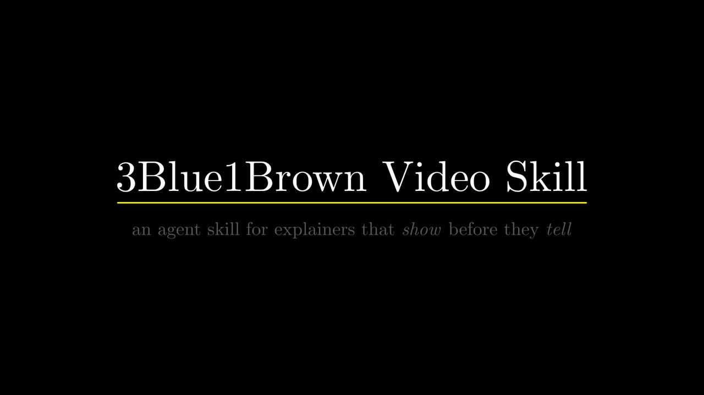

# 3Blue1Brown Video Skill

An agent skill that turns one sentence into a 3Blue1Brown-style explainer. Your agent writes the story, the storyboard and the Manim code, then renders a narrated film with a score.

[](https://arjunkshah12345-hash.github.io/3blue1brown-video-skill/)

**[Watch the films →](https://arjunkshah12345-hash.github.io/3blue1brown-video-skill/)** The site has eleven of them, all rendered by the skill's own example library.

## Install

Put the skill folder where your agent looks for skills:

```bash
git clone https://github.com/arjunkshah12345-hash/3blue1brown-video-skill ~/.claude/skills/3blue1brown-video
# Codex, Cursor and other agents that read ~/.agents/skills:
git clone https://github.com/arjunkshah12345-hash/3blue1brown-video-skill ~/.agents/skills/3blue1brown-video
```

To render locally you need [Manim Community](https://www.manim.community/) and LaTeX:

```bash
pip install manim
brew install --cask mactex-no-gui   # or TeX Live / TinyTeX
```

Or install nothing and render on Kaggle instead (see below).

## Use

Ask your agent:

> make a 3b1b-style video on why d/dx x² = 2x

The skill:

1. finds the question and the "aha" in the topic;
2. writes a three-act script (question, discovery, insight) before any code;
3. storyboards the visual beats;
4. writes the Manim scene using the `b3b/` library;
5. renders it with narration, music and sound cues mixed in.

## What's inside

| Path | What it is |
|---|---|
| `SKILL.md` | The skill: story structure, animation principles, code patterns, audio |
| `examples/` | Eleven working scenes: equation morphs, Fourier epicycles, linear maps, derivatives, and the launch film |
| `examples/b3b/` | The scene library: palette, captions, camera, Fourier, graphing and audio |
| `docs/` | Research notes on 3Blue1Brown's animation and narration techniques |
| `references/`, `templates/` | Storytelling reference and a starter scene |
| `scripts/` | Cloud rendering, audio mastering and a narration scaffold |
| `site/` | The launch site |

## Sound

Every `b3b` scene has sound with nothing extra to install:

- **Score:** a quiet felt-piano score in D major, synthesised with numpy and scipy, timed to the scene and laid under it automatically.
- **Cues:** plucks, chimes, whooshes and key clicks, placed with `self.cue(...)`.
- **Voiceover:** every caption is spoken. `B3B_VOICE` picks the voice:
  - `kokoro` uses the open Kokoro-82M model, no key needed;
  - `elevenlabs` uses ElevenLabs;
  - `say` uses macOS `say`, for drafts;
  - `none` is silent but keeps the timing.

## Render in the cloud

You need only the [`kaggle` CLI](https://github.com/Kaggle/kaggle-api), logged in. The script pushes a private Kaggle kernel, installs Manim, TeX and the Kokoro voice there, renders the scenes in parallel at 1080p60, and downloads the MP4s:

```bash
python3 scripts/kaggle_render.py examples out/ launch_film.py:LaunchFilm
scripts/master_audio.sh site/media out/*.mp4   # -16 LUFS for the web
```

## License

MIT. See [LICENSE](LICENSE).

This is an unofficial project, not affiliated with 3Blue1Brown or Grant Sanderson. It was made in admiration of their work, and builds on [Manim Community](https://www.manim.community/) and [3b1b/manim](https://github.com/3b1b/manim).
